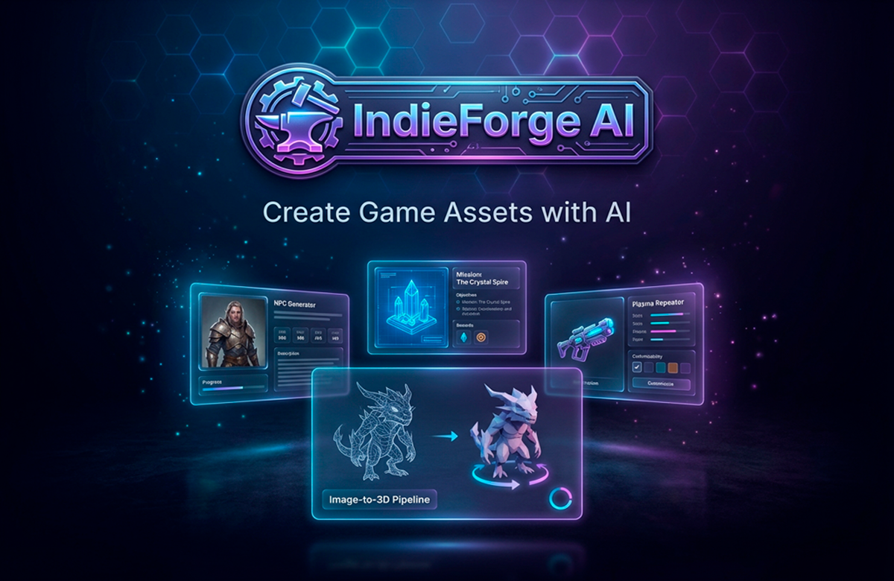
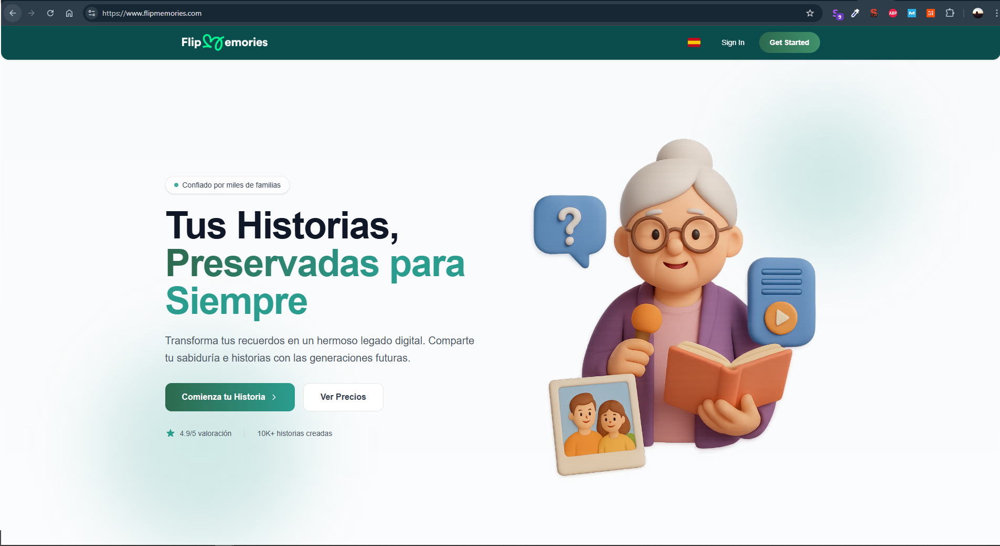
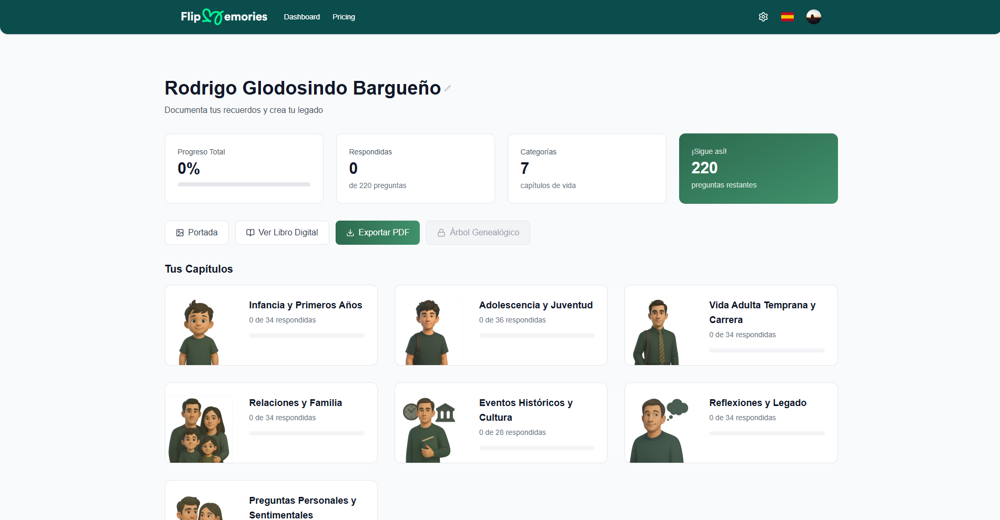
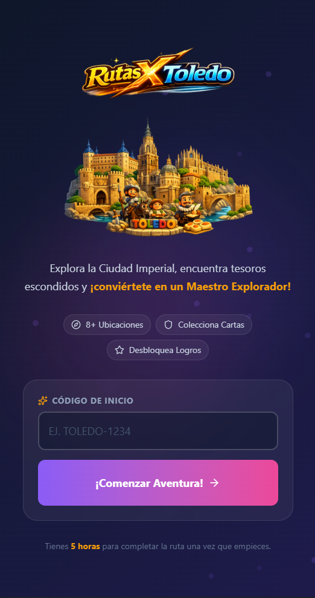
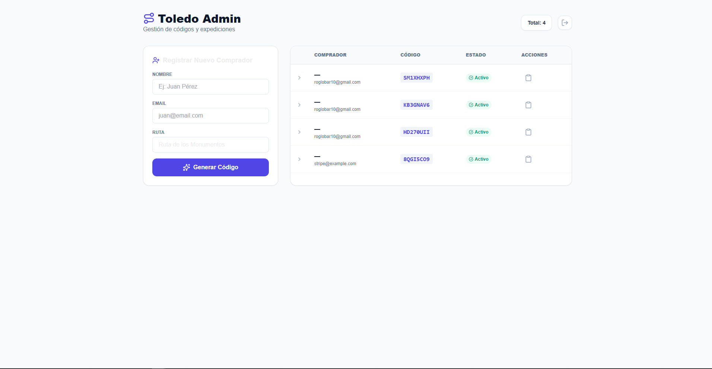
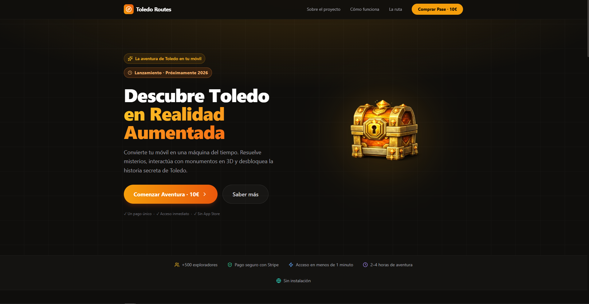
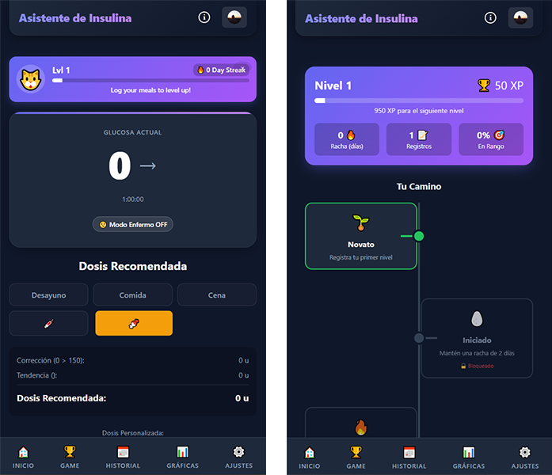
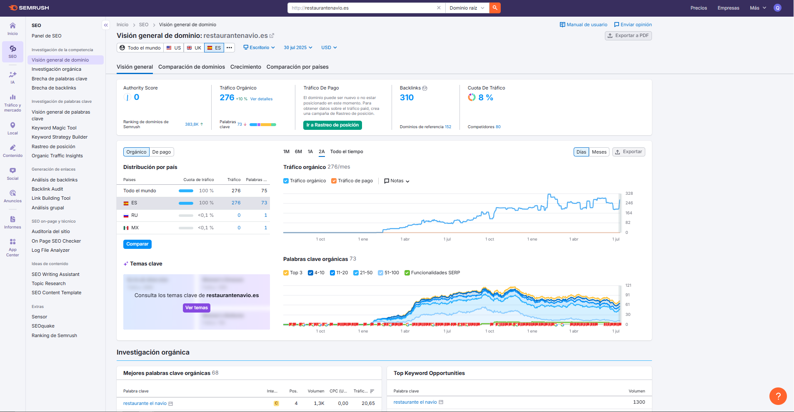
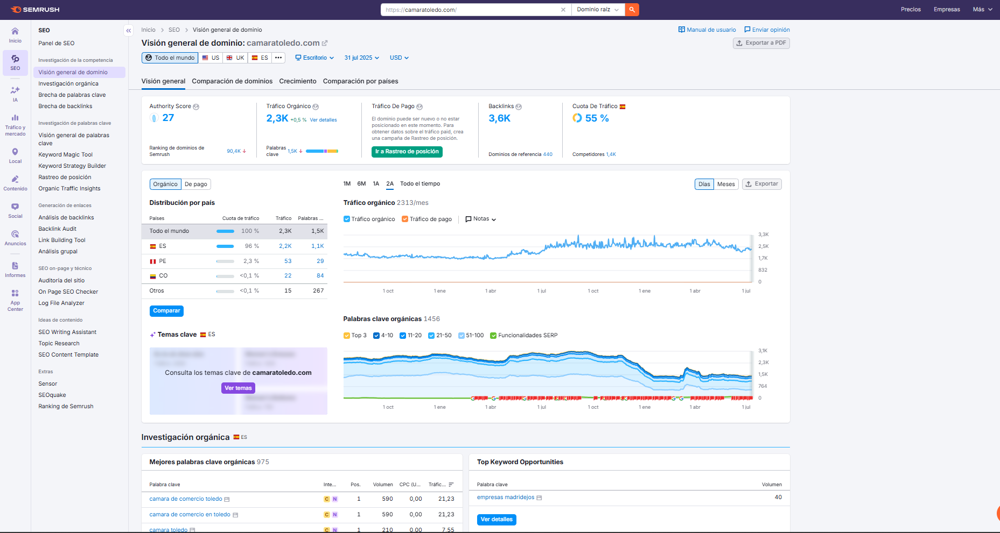
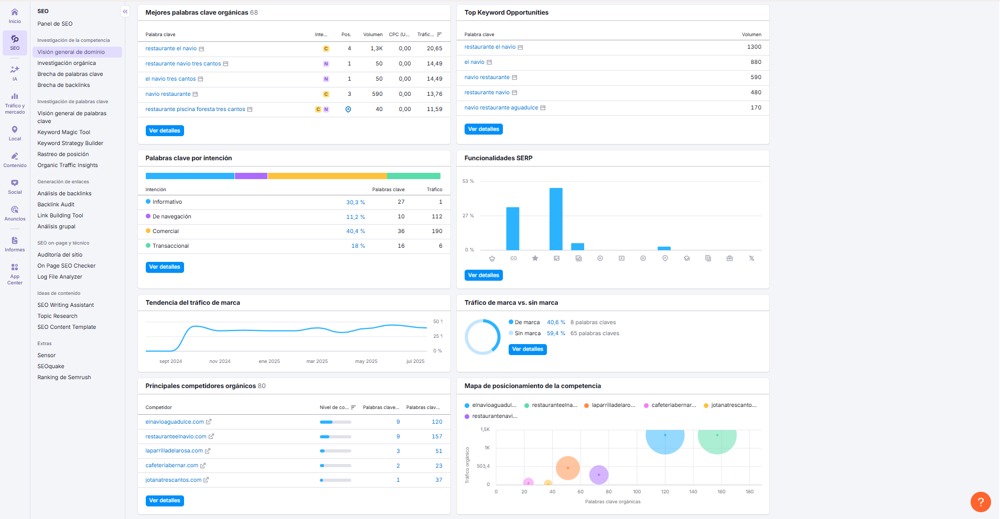

# ¡Hola! 👋 
## Soy Rodrigo, ¡encantado de conocerte!

¡Bienvenido/a a mi página de Github! Soy un desarrollador y diseñador web apasionado por crear soluciones innovadoras y eficientes en la web. Aquí encontrarás algunos de mis proyectos destacados, contribuciones recientes y más sobre mi trayectoria profesional.

Welcome to my GitHub page! I’m a passionate web developer and designer focused on creating innovative, efficient solutions for the web. Here you’ll find some of my featured projects, recent contributions, and more about my professional journey.

---

## 🏆⭐ Premios Recientes / Recent Awards ⭐🏆

> 🥇 **[ImpulsaStartup — Mejor Startup de Castilla y León](https://www.jcyl.es/web/es/empleo/impulsa-startup.html)**  
> Ganadores del programa **ImpulsaStartup** en Castilla y León con **[Neuraskin](https://neuraskin.com)** — startup de tecnología aplicada a la salud de la piel.  
> *Winners of the ImpulsaStartup program in Castilla y León with Neuraskin — health-tech startup focused on skin health.*

> 🥇 **[ImpulsaStartup — Toledo](https://www.jcyl.es/web/es/empleo/impulsa-startup.html)**  
> Ganadores del programa **ImpulsaStartup** en Toledo con **Rutas X Toledo** — plataforma de rutas gamificadas por la ciudad.  
> *Winners of the ImpulsaStartup program in Toledo with Rutas X Toledo — gamified city routes platform.*

---

### 🚀 Sobre mí / About me
- Desarrollador web en [Jerpublicidad](https://jerpublicidad.com), donde diseño y construyo interfaces modernas y funcionales.
- Experiencia en proyectos de alto impacto tanto freelance como en agencias.
Ampliando constantemente mis habilidades con tecnologías frontend y backend.
Colaboro en proyectos de código abierto y disfruto compartir conocimientos con la comunidad.
He trabajado tres meses impartiendo cursos de formación para [bilib.es](https://www.bilib.es/) en puntos de inclusión digital en Talavera, Méntrida, Camuñas e Illescas.

- Web developer at [Jerpublicidad](https://jerpublicidad.com), designing and building modern, functional interfaces.
- Experience in high-impact projects both freelance and at agencies.
I worked for three months teaching training courses for [bilib.es](https://www.bilib.es/) at digital inclusion centers in Talavera, Méntrida, Camuñas, and Illescas.
---

### 💼 Trabajos recientes / Recent Work

- **[Jerpublicidad](https://jerpublicidad.com/)**  
  Desarrollo y mantenimiento de la web corporativa y landing pages para campañas de marketing digital.  
  Corporate website development and maintenance, plus landing pages for digital marketing campaigns.

- **[Award Website](https://award-website-sigma.vercel.app/)**  
  Sitio web premiado, enfocado en la experiencia de usuario y el diseño visual.  
  _Desplegado en Vercel_  
  Award-winning website focused on user experience and visual design.

- **[Anime API Platform](https://www.animeapiplatform.com/)**  
  Plataforma para desarrolladores web, apps y más, que ofrece una API con información de más de 39,000 animes y también manga. Incluye un bot de IA para asistir a los usuarios, desarrollado con Next.js, Stripe, Drizzle Database y OpenAI.  
  Platform for web and app developers, providing an API with information on over 39,000 anime titles and manga. Includes an AI bot to assist users, built with Next.js, Stripe, Drizzle Database, and OpenAI.

---

### 🏆 Hackathon e Proyectos Indie / Hackathon & Indie Projects

- **Hackathon Cubepath 2026:** Participación en [Hackaton Cubepath](https://github.com/midudev/hackaton-cubepath-2026).
- **IndieForgeAI (Indieforge):** Código y demo: [IndieForgeAI-hackaton-main](https://github.com/dhren2019/IndieForgeAI-hackaton-main) — Demo en https://indieforgeai.194.26.100.150.sslip.io/

### FlipMemories — SaaS: Tus Historias, Preservadas para Siempre

 

  Aplicación web para crear historias familiares y árboles genealógicos. Permite completar un cuestionario de 220 preguntas para recopilar la historia completa de una persona, organizar a los familiares en un árbol genealógico y generar PDFs imprimables con la biografía o historia familiar lista para compartir o conservar. Ideal para proyectos de memoria familiar, recopilación de genealogía y generación de documentos imprimibles.  

  Web application to create family histories and genealogical trees. It includes a 220-question guided questionnaire to collect a person's full life story, tools to organize relatives into a family tree, and the ability to generate printable PDFs with the complete personal history ready to share or archive. Ideal for family memory projects, genealogy collection, and printable document generation.  

### ⭐ Rutas por Toledo — Plataforma de rutas gamificadas en Toledo *(Premio ImpulsaStartup Toledo 🏆)*

- **Backend:**   
- **Frontend / Venta de entradas & códigos:**   

Plataforma Frontend, Backend y WebApp de rutas gamificadas por Toledo.  
Frontend, Backend and WebApp platform for gamified routes around Toledo.

### Asistente de Insulina — Web app

  
  

Conectado a mi parche de glucosa; obtiene mediciones cada minuto, aprende mediante Machine Learning y recomienda unidades de insulina según sensibilidad y feedback supervisado. Incluye gamificación.  

Connected to my glucose patch; retrieves readings every minute, learns via Machine Learning and recommends insulin units based on sensitivity and supervised feedback. Includes gamification.

---
### Otros proyectos / Other projects

- **[AI Study](https://ai-study-theta.vercel.app/)**  
  Plataforma de aprendizaje personalizado con inteligencia artificial.  
  _Desplegado en Vercel_  
  AI-powered personalized learning platform.  
  _Deployed on Vercel_

- **[Book AI 2024](https://book-ai-2024.vercel.app/)**  
  Aplicación de recomendaciones de libros usando IA.  
  _Desplegado en Vercel_  
  Book recommendation app powered by AI.  
  _Deployed on Vercel_

- **[Market Verse Trader](https://market-verse-trader.vercel.app/)**  
  Dashboard de trading de criptomonedas con visualizaciones en tiempo real y gestión de portafolio.  
  _Desplegado en Vercel_  
  Cryptocurrency trading dashboard with real-time visualization and portfolio management.  
  _Deployed on Vercel_

- **[Starter SaaS Boilerplate](https://roglobar.gumroad.com/l/COMPLETE-SAAS-STARTER-BOILERPLATE)**  
  Plantilla completa para arrancar proyectos SaaS: incluye interfaz (UI), autenticación, integración con Stripe, dashboards y ejemplos listos para desplegar. _Enlace de compra en Gumroad._  
  Complete SaaS starter boilerplate including UI, authentication, Stripe payments integration, dashboards and ready-to-deploy examples. _Purchase: Gumroad._

- **[AI NEWS HUB — Complete SaaS Product Ready to Launch](https://roglobar.gumroad.com/l/ainewshub-complete-saas-ready-to-use)**  
  Producto SaaS completo para agregación y curación de noticias con IA; incluye panel de administración, sistema de suscripciones y despliegue listo para producción. _Enlace de compra en Gumroad._  
  AI-powered news hub SaaS product with aggregation and AI curation, admin panel, subscription system and ready-to-launch deployment. _Purchase: Gumroad._

- **[AI Coaching Voice Agent](https://ai-coaching-voice-agent.vercel.app/)**  
  Asistente coaching por voz con IA y análisis de conversaciones.  
  _Desplegado en Vercel_  
  Voice coaching assistant with AI and conversation analysis.  
  _Deployed on Vercel_

- **[Spotlight](https://spotlight-80w.vercel.app/)**  
  Plataforma para destacar perfiles y proyectos innovadores.  
  _Desplegado en Vercel_  
  Platform to showcase innovative profiles and projects.  
  _Deployed on Vercel_

- **[Personal AI Assistant](https://personal-ai-assistant.vercel.app/)**  
  Asistente personal con IA para tareas cotidianas y gestión de información.  
  _Desplegado en Vercel_  
  AI-powered personal assistant for daily tasks and information management.  
  _Deployed on Vercel_

- **[Email Marketing](https://email-marketing-dhren.vercel.app/)**  
  Herramienta para campañas de email marketing con analítica personalizada.  
  _Desplegado en Vercel_  
  Tool for email marketing campaigns with custom analytics.  
  _Deployed on Vercel_

- **[Bot Clone](https://bot-clone.vercel.app/)**  
  Implementación de chatbot personalizado para atención automatizada.  
  _Desplegado en Vercel_  
  Custom chatbot implementation for automated support.  
  _Deployed on Vercel_

- **[Wantframe 3D](https://wantframe-3d-4i.vercel.app/)**  
  Aplicación para visualización y edición de marcos 3D personalizados.  
  _Desplegado en Vercel_  
  App for visualization and editing of custom 3D frames.  
  _Deployed on Vercel_

---

### 💼 Trabajos SEO y Marketing Digital / SEO & Digital Marketing Work

Me especializo en el desarrollo de aplicaciones SaaS modernas utilizando tecnologías de vanguardia como Next.js, Stripe para pagos, integración de IA y otras herramientas avanzadas. Aquí algunos ejemplos de mi trabajo en SEO y marketing digital:

I specialize in developing modern SaaS applications using cutting-edge technologies like Next.js, Stripe for payments, AI integration, and other advanced tools. Here are some examples of my SEO and digital marketing work:

**🚀 Mi pasión por las aplicaciones SaaS / My passion for SaaS applications:**
- Desarrollo de plataformas escalables con Next.js y React
- Integración de sistemas de pago seguros con Stripe
- Implementación de IA para mejorar la experiencia del usuario
- Optimización SEO para maximizar la visibilidad orgánica
- Análisis de métricas y conversiones para optimización continua

- Development of scalable platforms with Next.js and React
- Integration of secure payment systems with Stripe
- AI implementation to enhance user experience
- SEO optimization to maximize organic visibility
- Metrics and conversion analysis for continuous optimization

---

### 💻 Tecnologías y herramientas / Technologies & Tools

- **Lenguajes / Languages:** JavaScript, HTML5, CSS3, PHP, TypeScript  
- **Frameworks y bibliotecas / Frameworks & Libraries:** React, Next.js, Drizzle  
- **Bases de datos / Databases:** Neon DB, MySQL, Prisma  
- **APIs:** API Gemini, RESTful APIs, Stripe  
- **Herramientas / Tools:** SASS, Webpack, Git, Vercel, Node.js, Vite, n8n

---

### 📈 Estadísticas de GitHub / GitHub Stats

---

### 📊 Otras estadísticas / More Stats

---

### 🔥 Mis contribuciones / My Contributions

- **[Todolist](https://github.com/dhren2019/todolist)** - Aplicación interactiva de lista de tareas con almacenamiento local. [Ver commits](https://github.com/dhren2019/todolist/commits/main)  
  Interactive todo list app with local storage. [See commits](https://github.com/dhren2019/todolist/commits/main)
- **[Githubjobs](https://github.com/dhren2019/githubjobs)** - Plataforma que muestra ofertas de empleo utilizando la API de GitHub Jobs. [Ver commits](https://github.com/dhren2019/githubjobs/commits/main)  
  Platform showing job offers using GitHub Jobs API. [See commits](https://github.com/dhren2019/githubjobs/commits/main)
- **[English Quiz](https://github.com/Lemoncode/english-quiz)** - Contribuí a este proyecto de un quiz interactivo para mejorar el inglés. [Ver commits](https://github.com/Lemoncode/english-quiz/commits/main)  
  Contributed to this interactive quiz project to improve English skills. [See commits](https://github.com/Lemoncode/english-quiz/commits/main)

---

### 🌱 Desafíos y metas / Challenges & Goals
- Seguir profundizando en frameworks de JavaScript como React y Next.js.   
  Keep deepening my knowledge in JavaScript frameworks like React and Next.js.
- Contribuir regularmente a proyectos de código abierto.  
  Contribute regularly to open-source projects.
- Mantener una rutina de programación diaria.  
  Maintain a daily coding routine.

---

### 🌐 Encuéntrame en línea / Find me online
- Visita mi [GitHub](https://github.com/dhren2019) para ver más proyectos y contribuciones.  
  Visit my [GitHub](https://github.com/dhren2019) for more projects and contributions.
- Contáctame por [email](mailto:roglobar10@gmail.com) para colaborar o si tienes alguna pregunta.  
  Contact me by [email](mailto:roglobar10@gmail.com) for collaboration or questions.

 ### 🛠️ Otros conocimientos / Other skills

- Photoshop, Illustrator, InDesign, FTP, servidores privados, GitHub, IA, migración de webs y emails, Inglés B2
- Photoshop, Illustrator, InDesign, FTP, private servers, GitHub, AI, website and email migration, English B2

<!-- Este README fue creado por Dhren -->
⭐️ De [Dhren](https://github.com/dhren2019)

---
